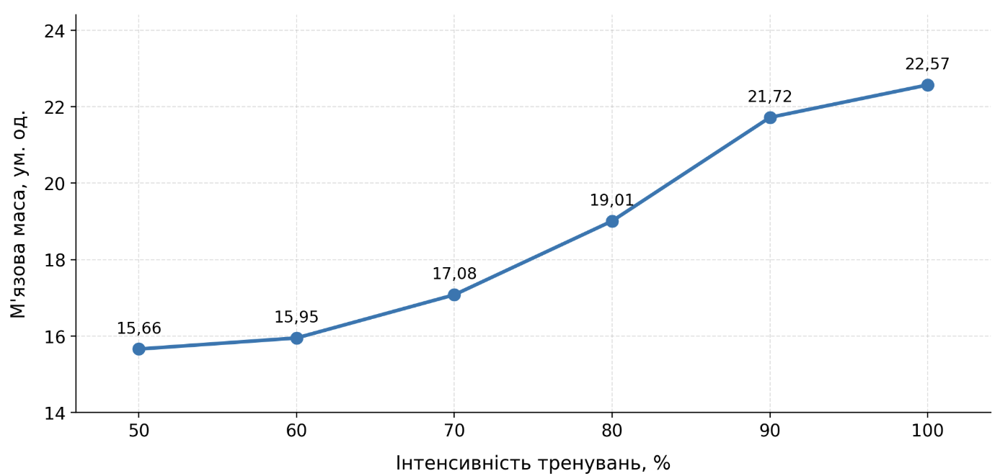
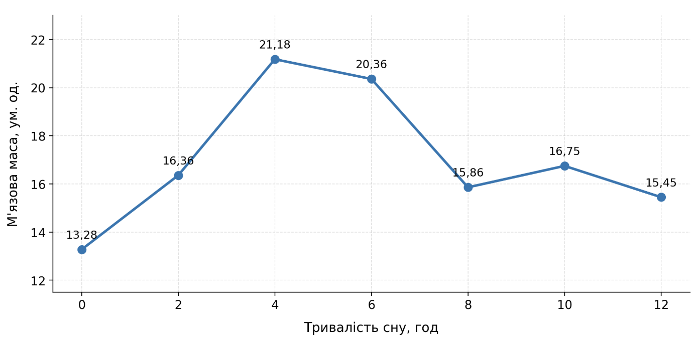

## Комп'ютерні системи імітаційного моделювання
## СПм-25-2, **Смотрова Анастасія Олександрівна**
### Лабораторна робота №**1**. Опис імітаційних моделей та проведення обчислювальних експериментів

 

### Варіант 12, модель у середовищі NetLogo:
[Muscle Development] http://www.netlogoweb.org/launch#http://www.netlogoweb.org/assets/modelslib/Sample%20Models/Biology/Muscle%20Development.nlogo)

 

### Вербальний опис моделі:
Це модель фізіології фізичних навантажень. Вона покликана допомогти вам зрозуміти фактори, що впливають на формування належного гормонального балансу для нарощування м’язів під час занять з підняттям ваги.

### Керуючі параметри:
- **intensity** визначає інтенсивність тренування, яка визначає ймовірність залучення м'язових волокон до навантаження.
- **hours-of-sleep** визначає тривалість сну, що впливає на зміну концентрації анаболічних і катаболічних гормонів.
- **days-between-workouts** визначає кількість днів між силовими тренуваннями.
- **%-slow-twitch-fibers** визначає частку повільних м'язових волокон, яка впливає на розподіл їхніх максимально можливих розмірів.
- **lift** визначає, чи виконуються силові тренування під час моделювання.

### Внутрішні параметри:
- **fiber-size**. Визначає розмір окремого волокна, який змінюється залежно від гормонального середовища.
- **max-size**. Встановлює верхню межу розвитку окремого волокна.
- **anabolic-hormone**. Характеризує рівень анаболічного впливу в певній ділянці середовища.
- **catabolic-hormone**. Характеризує рівень катаболічного впливу в певній ділянці середовища.

### Показники роботи системи:
- Muscle Mass. Показник розвитку м'язової маси, що характеризує сумарний розмір м'язових волокон.
- Anabolic. Рівень анаболічних гормонів, які сприяють збільшенню м'язової маси.
- Catabolic. Рівень катаболічних гормонів, які беруть участь у процесах розпаду м'язової тканини.

### Примітки:
Людський організм - це надзвичайно складна система. Щоб змоделювати ту його частину, яка нас цікавить, було зроблено певні припущення щодо поведінки інших частин. Це простежується у жорсткому задаванні різних параметрів, таких як межі рівня гормонів та максимальні розміри м’язових волокон. Ці припущення дають нам змогу зосередитися на розумінні загального процесу розвитку м’язів, не перевантажуючи себе надмірною кількістю інформації.

### Недоліки моделі:
Модель використовую параметр кількості днів між тренуванням, але сама мета моделі продемонструвати формування належного гормонального балансу для нарощування м’язів. Максимальне значення цього параметра 30, але навіть не задумуючись можна сказати що при тренуванні раз на місяць результату не буде. Тому тут потрібна заміна або додатковий параметр, наприклад кількість тренування з підняттям ваги на тиждень.

 

## Обчислювальні експерименти
### 1. Вплив зміни інтенсивномті тренувань на показник розвитку м'язової маси
Досліджується залежність розвитку м'язової маси від інтенсивності тренувань в однаковий часовий проміжок (100 тактів) 
Експерименти проводяться з кроком 10, усього 6 симуляцій.  
Інші керуючі параметри мають значення за замовчуванням:
- **hours-of-sleep**: 8
- **days-between-workouts**: 5
- **%-slow-twitch-fibers**: 50
- **lift**: true

<table>
<thead>
<tr><th>Інтенсивність тренувань</th><th>Кількість м'язової маси</th></tr>
</thead>
<tbody>
<tr><td>50</td><td>15.66</td></tr>
<tr><td>60</td><td>15.95</td></tr>
<tr><td>70</td><td>17.08</td></tr>
<tr><td>80</td><td>19.01</td></tr>
<tr><td>90</td><td>21.72</td></tr>
<tr><td>100</td><td>22.57</td></tr>
</tbody>
</table>

Графік наочно показує, що зростання м'язової маси спостерігається зі збільшенням інтенсивності тренувань.

### 2. Вплив зміни кількості сну на показник розвитку м'язової маси
Досліджується залежність розвитку м'язової маси від кількості годин сну в однаковий часовий проміжок (100 тактів) 
Експерименти проводяться з кроком 2, усього 7 симуляцій.  
Інші керуючі параметри мають значення за замовчуванням:
- **intensity**: 70
- **days-between-workouts**: 5
- **%-slow-twitch-fibers**: 50
- **lift**: true

<table>
<thead>
<tr><th>Кількість годин сну</th><th>Кількість м'язової маси</th></tr>
</thead>
<tbody>
<tr><td>0</td><td>13.28</td></tr>
<tr><td>2</td><td>16.36</td></tr>
<tr><td>4</td><td>21.18</td></tr>
<tr><td>6</td><td>20.36</td></tr>
<tr><td>8</td><td>15.86</td></tr>
<tr><td>10</td><td>16.75</td></tr>
<tr><td>12</td><td>15.45</td></tr>
</tbody>
</table>

Графік  показує, що найбільше значення м'язової маси отримано за тривалості сну 4 години. При подальшому збільшенні тривалості сну спостерігаються коливання показника.

### 3. Вплив зміни частки повільних м'язових волокон на рівень анаболічних гормонів
Досліджується залежність рівня анаболічних гормонів від зміни частки повільних м'язових волокон в однаковий часовий проміжок (100 тактів) 
Експерименти проводяться з кроком 10, усього 11 симуляцій.  
Інші керуючі параметри мають значення за замовчуванням:
- **intensity**: 70
- **hours-of-sleep**: 7
- **days-between-workouts**: 5
- **lift**: true

<table>
<thead>
<tr><th>Відсоток повільних м'язових волокон</th><th>Рівень анаболічних гормонів</th></tr>
</thead>
<tbody>
<tr><td>0</td><td>140.57</td></tr>
<tr><td>10</td><td>130.92</td></tr>
<tr><td>20</td><td>113.03</td></tr>
<tr><td>30</td><td>92.54</td></tr>
<tr><td>40</td><td>63.42</td></tr>
<tr><td>50</td><td>52.94</td></tr>
<tr><td>60</td><td>50.01</td></tr>
<tr><td>70</td><td>50.01</td></tr>
<tr><td>80</td><td>50.0</td></tr>
<tr><td>90</td><td>50.0</td></tr>
<tr><td>100</td><td>50.0</td></tr>
</tbody>
</table>

Графік  показує, що найбільше значення м'язової маси отримано за тривалості сну 4 години. При подальшому збільшенні тривалості сну спостерігаються коливання показника.

### 4. Вплив зміни частки повільних м'язових волокон на рівень катаболічнийх гормонів
Досліджується залежність рівня катаболічнийх гормонів від зміни частки повільних м'язових волокон в однаковий часовий проміжок (100 тактів) 
Експерименти проводяться з кроком 10, усього 11 симуляцій.  
Інші керуючі параметри мають значення за замовчуванням:
- **intensity**: 70
- **hours-of-sleep**: 7
- **days-between-workouts**: 5
- **lift**: true

<table>
<thead>
<tr><th>Відсоток повільних м'язових волокон</th><th>Рівень катобалічних гормонів</th></tr>
</thead>
<tbody>
<tr><td>0</td><td>56.39</td></tr>
<tr><td>10</td><td>55.83</td></tr>
<tr><td>20</td><td>53.5</td></tr>
<tr><td>30</td><td>52.05</td></tr>
<tr><td>40</td><td>52.01</td></tr>
<tr><td>50</td><td>52.0</td></tr>
<tr><td>60</td><td>52.0</td></tr>
<tr><td>70</td><td>52.0</td></tr>
<tr><td>80</td><td>52.0</td></tr>
<tr><td>90</td><td>52.0</td></tr>
<tr><td>100</td><td>52.0</td></tr>
</tbody>
</table>

Графік  показує, що найбільше значення м'язової маси отримано за тривалості сну 4 години. При подальшому збільшенні тривалості сну спостерігаються коливання показника.

